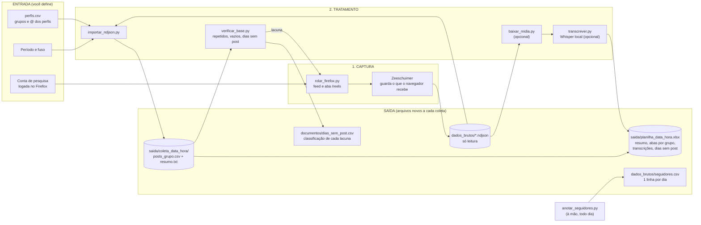
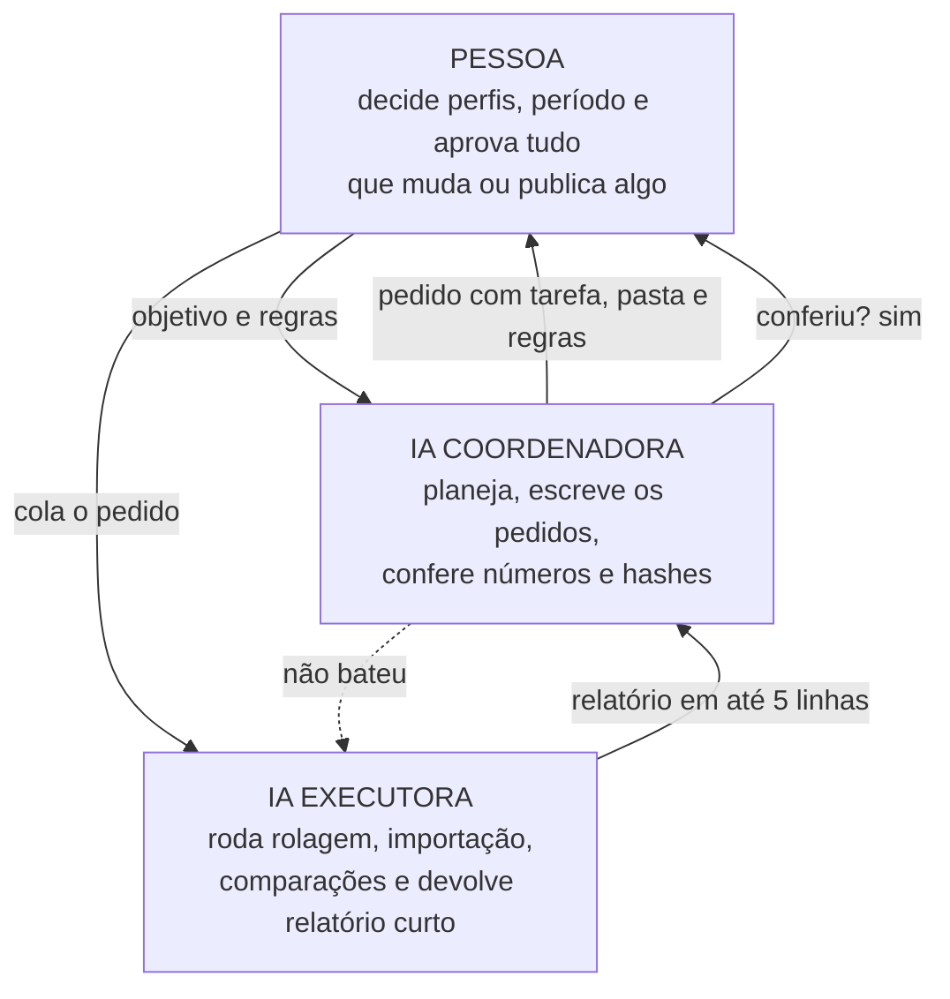

# Posts públicos do Instagram para pesquisa: método de coleta com Firefox + IA

Um jeito gratuito e repetível de montar uma base de posts de perfis **públicos** do Instagram (data, formato, legenda, curtidas, comentários em número, reproduções de vídeo), sem API paga, sem programar e com um agente de IA fazendo a parte chata.

Nasceu em um projeto de iniciação científica sobre perfis políticos. Aqui vai **só o método**: nenhum dado, nenhum perfil da pesquisa original.

## O que você precisa

| | |
|---|---|
| Computador | Mac, Windows ou Linux. O script de rolagem aperta Page Down no Firefox; no Mac ele também percebe se o Firefox saiu da frente. Linux precisa do `xdotool`. |
| Navegador | Firefox, com a extensão gratuita [Zeeschuimer](https://github.com/digitalmethodsinitiative/zeeschuimer). |
| Conta | Uma conta do Instagram **criada para a pesquisa** (nunca a sua pessoal). |
| Python | Versão 3.9 ou mais nova. Os scripts principais não precisam de pacote nenhum. Só a transcrição (`faster-whisper`) e a planilha (`openpyxl`) pedem instalação, e são opcionais. |
| IA | Opcional, mas é o que deixa fácil: Claude Code, Codex, Gemini CLI ou similar. |

## Como funciona, em uma frase

Você abre o perfil no Firefox, um script rola a página como uma pessoa lendo, a extensão guarda o que o Instagram manda para o navegador, e outro script transforma isso em planilha. Cada coleta vira um arquivo novo com data e hora; nada é apagado nem sobrescrito.

### Do que entra ao que sai

### Quem faz o quê (com IA)

Quem confere não deve ser quem executou. Os pedidos prontos estão em [`modelos/REGRAS_PARA_A_IA.md`](modelos/REGRAS_PARA_A_IA.md).

## Comece por aqui

1. Leia o [`PASSO_A_PASSO.md`](PASSO_A_PASSO.md). É uma lista numerada; cada passo diz o que fazer e como saber que deu certo.
2. Se for usar IA: abra o agente **dentro da pasta do projeto** e cole o texto de [`COLE_NA_IA.md`](COLE_NA_IA.md). Ele lê este repositório e conduz os passos com você.

## O que tem no repositório

| Arquivo | Para quê |
|---|---|
| `PASSO_A_PASSO.md` | O tutorial inteiro, do zero à base verificada |
| `COLE_NA_IA.md` | Texto para colar no agente de IA |
| `scripts/rolar_firefox.py` | Rola o perfil sozinho (Mac, Windows e Linux) |
| `scripts/importar_ndjson.py` | Transforma o `.ndjson` em CSV |
| `scripts/verificar_base.py` | Confere a base e lista os dias sem post |
| `scripts/anotar_seguidores.py` | Registra os seguidores do dia (a extensão não traz) |
| `scripts/baixar_midia.py` | Baixa vídeos e imagens dos posts (opcional) |
| `scripts/transcrever.py` | Transcreve o áudio dos vídeos, no seu computador (opcional) |
| `scripts/gerar_planilha.py` | Junta tudo numa planilha `.xlsx` nova, com dicionário de colunas |
| `modelos/perfis.csv` | Modelo da lista de perfis a coletar |
| `modelos/REGRAS_PARA_A_IA.md` | Regras do projeto; vira `CLAUDE.md` ou `AGENTS.md` na sua pasta |
| `docs/dicionario_colunas.md` | O que significa cada coluna da planilha |
| `docs/o_que_tentamos_antes.md` | Caminhos que falharam ou custaram caro, para você não repetir |
| `docs/etica_e_limites.md` | O que não coletar, o que declarar, o que ainda depende do seu orientador |

## O que a técnica traz e o que não traz

**Traz:** data e hora do post, formato (imagem, carrossel, vídeo, reels), legenda, hashtags, menções, coautores, curtidas, número de comentários, visualizações e reproduções de vídeo, se é parceria paga, se está fixado.

**Não traz:** texto dos comentários, número de seguidores (anote à mão, todo dia), stories (somem em 24 h). Reproduções de vídeo só aparecem na aba **Reels** do perfil, por isso o método rola duas abas.

## Licença e créditos

Extensão Zeeschuimer: Digital Methods Initiative (Universidade de Amsterdã), licença MPL 2.0, só para Firefox. Os scripts deste repositório: licença MIT (veja `LICENSE`).

Termos de uso da plataforma, LGPD e comitê de ética: veja [`docs/etica_e_limites.md`](docs/etica_e_limites.md) e confirme com seu orientador antes de coletar.
