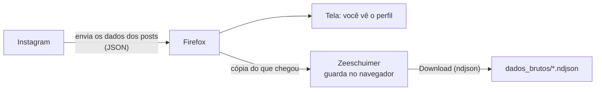

# Como o Zeeschuimer funciona

O [Zeeschuimer](https://github.com/digitalmethodsinitiative/zeeschuimer) é uma extensão do Firefox criada pela Digital Methods Initiative (Universidade de Amsterdã). Ele **não "raspa" o Instagram por conta própria**: ele guarda uma cópia do que o Instagram já mandou para o seu navegador enquanto você navega.

## A ideia em 4 passos

1. **Você navega normalmente.** Abre um perfil público no Firefox, logado na conta criada para a pesquisa, com a chave do Instagram ligada no ícone **Z**.
2. **O Instagram manda os dados.** Para montar a página, o Instagram envia ao navegador as informações dos posts (data, legenda, curtidas, número de comentários, reproduções) em formato estruturado (JSON). É o mesmo dado que alimenta o que aparece na tela.
3. **A extensão intercepta e guarda.** Conforme essas respostas chegam ao navegador, o Zeeschuimer guarda uma cópia local. Ele não faz pedidos extras ao Instagram; o contador do **Z** sobe a cada lote de posts recebido.
4. **Você baixa o arquivo.** No **Z**, em *Download* (formato **ndjson**), sai um arquivo com um post por linha. O `importar_ndjson.py` transforma esse arquivo em CSV.

## Por que existe o script de rolagem

O Instagram só envia mais posts quando a página rola. Como o Zeeschuimer só guarda o que chega ao navegador, o `rolar_firefox.py` aperta Page Down num ritmo de pessoa lendo para o Instagram mandar os posts mais antigos. **O script não lê nada**: quem captura é a extensão. Se preferir, role à mão; o resultado é o mesmo.

## O que isso significa para a pesquisa

- **Captura passiva:** só entra na base o que o Instagram enviou ao navegador. Post que não carregou na rolagem não entra (por isso o importador avisa quando o post mais antigo ainda é posterior ao início do período).
- **Só o que a interface recebe:** texto dos comentários, seguidores e stories não vêm nesses dados.
- **Duas abas:** a grade do perfil não traz reproduções de vídeo; a aba **Reels** traz. Por isso o método rola as duas.
- **Acúmulo:** cada download inclui tudo o que já foi capturado. Clique em **Delete** no **Z** depois de baixar, para não repetir dados no próximo perfil.
- **Dados brutos preservados:** o `.ndjson` é a fonte original e fica em `dados_brutos/`, somente leitura.
- **Dependência do formato do Instagram:** se a plataforma mudar o formato dos dados, a extensão (e o importador) podem precisar de atualização.

## Limites e ética

Veja [`etica_e_limites.md`](etica_e_limites.md). Colete apenas perfis públicos e confirme com seu orientador antes.
